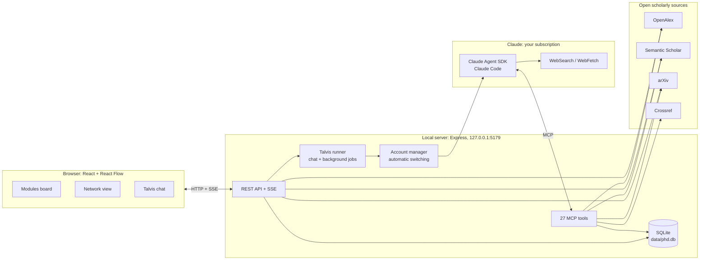
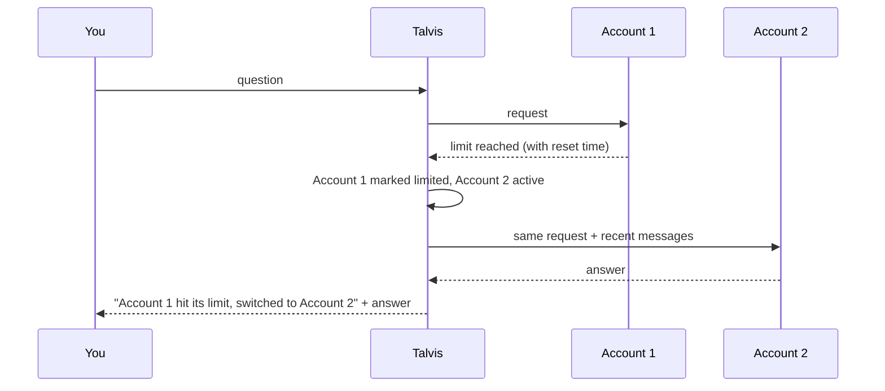

# PhD Analyzer

**Analyze, plan and run your whole PhD journey, powered by Talvis.** Everything lives on one screen: universities and deadlines, research topics, who works on what, real papers, research gaps, publication venues and your daily plan. At the center sits **Talvis**, a Claude-powered assistant that sees the entire system and works only from real sources.


> The user interface is in Azerbaijani. Button names below are given in Azerbaijani with an English translation in parentheses.

---

## Contents

- [What it does](#what-it-does)
- [Interface](#interface)
- [Talvis: the AI core](#talvis-the-ai-core)
- [Connected services and technologies](#connected-services-and-technologies)
- [Architecture](#architecture)
- [Modules](#modules)
- [Background research jobs](#background-research-jobs)
- [Talvis tools](#talvis-tools)
- [Claude accounts and automatic switching](#claude-accounts-and-automatic-switching)
- [Installation and running](#installation-and-running)
- [First steps](#first-steps)
- [Settings](#settings)
- [Data and privacy](#data-and-privacy)
- [Project structure](#project-structure)
- [API](#api)
- [Troubleshooting](#troubleshooting)
- [License](#license)

---

## What it does

| Need | How the system handles it |
|---|---|
| Which universities should I apply to? | Finds universities that match your profile criteria (research directions, countries, QS/THE/ARWU ranking limit, conditions such as "no IELTS/TOEFL required"), and records each ranking and language requirement **with an official source link** |
| Who works on my topic at this university? | Finds authors at a university for a topic via OpenAlex: h-index, number of matching papers, and whether they are still affiliated there |
| Their publications | Filters a researcher's papers by topic; adds them to your library in one click |
| Deadlines | Taken from official pages, marked "verified / unverified", with a countdown |
| What should I do today? | Builds a daily plan from deadlines, unread papers and professors you have not contacted yet |
| Research gaps | Scans the literature across OpenAlex, Semantic Scholar and arXiv, records each gap with evidence papers and checks whether it is already solved |
| Where should I publish? | Suggests real journals and conferences where similar work appears, with h-index, OA/APC, DOAJ status and predatory-journal warnings |
| SOP, research proposal, emails to professors | Drafts and reviews documents using the real data on your board |

Core principle: **nothing is made up.** Papers, authors, venues, rankings and deadlines come only from tool results or official pages (see the [integrity rules](#integrity-rules) below).

## Interface

- **Modules view:** the Talvis chat in the center, surrounded by 11 module cards arranged in neural-network layers. Cards are connected with lines; when Talvis works on a module, that card and its path to the core light up. Cards can be dragged, resized and zoomed; the layout is remembered.
- **Network view:** every object (you, topics, universities, groups, researchers, papers, gaps, venues, deadlines) shown as a knowledge graph on the left, with the Talvis chat docked on the right. Drag the divider to resize the chat; module panels open over the graph and never cover the chat.
- **HUD:** date, time, countdown to the next deadline, today's tasks, library size and the active Claude account.
- Design: dark "Jarvis"-style HUD with Inter and JetBrains Mono fonts (Azerbaijani characters supported).

## Talvis: the AI core

Talvis runs on the **Claude Agent SDK**, so the Claude Code engine powers it, but only this system's tools are allowed:

- On every message it receives a full summary of the board (profile, criteria, topics, universities, deadlines, tasks, researchers, papers, gaps, venues, documents).
- Anything lasting you tell it (a topic, a university, a decision) is saved to the board right away.
- It replies in Azerbaijani, keeps paper titles in their original language, and refers to board items by IDs such as `[P12]` or `[R3]`.
- Long tasks (gap analysis, university search, and so on) run as [background jobs](#background-research-jobs) and post their report to the chat.

### Integrity rules

These are not just instructions; the tools themselves enforce them:

| Rule | How it is enforced |
|---|---|
| Papers cannot be invented | `save_papers` accepts only IDs (OpenAlex, DOI, arXiv, Semantic Scholar); title, authors, year and abstract are fetched from the source on the server |
| No gap without evidence | `add_gap` accepts only references to papers that are already in the library |
| No "verified" deadline without a source | `add_deadline` requires an official `sourceUrl` for `verified=true` |
| No ranking or language requirement without a source | `add_university` requires `rankSource` for `rankLabel` and `langCertSource` for `langCert` |
| DOI check | `verify_doi` confirms on Crossref that a DOI actually exists |

## Connected services and technologies

### External services

| Service | Used for | Key | Notes |
|---|---|---|---|
| **Claude** (Anthropic) | The brain of Talvis: chat, planning, analysis, gap finding | Not needed: sign in with a Claude subscription (Pro/Max) via OAuth | Claude Agent SDK; Claude Opus 5.5 by default, Claude Sonnet 5.5 as fallback. Multiple accounts supported |
| **Claude WebSearch / WebFetch** | Official university pages, rankings, language requirements, deadlines, calls for papers | Included with the Claude sign-in | Used by Talvis only |
| **[OpenAlex](https://openalex.org)** | Paper search, citations, institution search, "who works on this", researcher publications, venue statistics (h-index, OA, DOAJ, APC), topic trends | Optional (free) | Without a key there is a small free daily budget per IP; get a free key at [openalex.org/settings/api](https://openalex.org/settings/api) |
| **[Semantic Scholar](https://www.semanticscholar.org/product/api)** | Paper search, TLDR summaries, similar-paper recommendations | Optional | Strict rate limits without a key; the system queues requests and retries |
| **[arXiv API](https://info.arxiv.org/help/api/index.html)** | The newest preprints | Not needed | Respects the one-request-per-3-seconds rule; when arXiv blocks requests, arXiv papers come from OpenAlex's arXiv index instead |
| **[Crossref](https://www.crossref.org/documentation/retrieve-metadata/rest-api/)** | DOI verification | Not needed | |

All external responses are cached in SQLite (from 6 hours up to 30 days), so repeated queries do not waste rate limits.

### Local technologies

| Part | Technology |
|---|---|
| Server | Node.js 20+, Express 5, TypeScript (tsx) |
| Database | SQLite (better-sqlite3), WAL mode |
| AI integration | `@anthropic-ai/claude-agent-sdk` (bundles Claude Code), in-process MCP server, `zod` schemas |
| Live updates | Server-Sent Events (SSE) |
| Frontend | React 19, Vite 6, React Flow (`@xyflow/react`) 12, d3-force, react-markdown + remark-gfm, lucide-react |
| Fonts | Inter, JetBrains Mono (`@fontsource`, offline) |
| XML | fast-xml-parser (arXiv Atom feed) |

## Architecture



How a question flows: you type in the chat → the server sends it to Talvis together with the board summary → Talvis calls the tools it needs (for example an OpenAlex search, then saving results to the library) → each tool call lights up the matching card on the board → the answer streams into the chat and the board refreshes automatically.

## Modules

| # | Module | What it stores | Main actions |
|---|---|---|---|
| M-01 | **Profil** (Profile) | Name, field, stage, target intake, citizenship, education (with teaching language), research directions, target countries, ranking limit, extra conditions | Criteria-based university search; Claude accounts; settings |
| M-02 | **Universitetlər** (Universities) | University, country, ranking (with source), language-test requirement (with source), fit note, status | Search by name in OpenAlex; "Kəşf et" (Scout: researchers, groups, deadlines); deadline check |
| M-03 | **Deadline-lar** (Deadlines) | Application, scholarship, interview, document, conference and journal dates | Verify against official sources; verified / unverified; countdown |
| M-04 | **Bugün** (Today) | Tasks (overdue / today / upcoming) | AI daily plan; todo → in progress → done |
| M-05 | **Sənədlər** (Documents) | SOP, research proposal, CV, emails, cover letters, notes | Editor; "Talvis yazsın" (Talvis drafts), "Talvis yoxlasın" (Talvis reviews) |
| M-06 | **Mövzular** (Topics) | Topics, keywords, priority | Gap analysis; paper search; OpenAlex publication trend |
| M-07 | **Tədqiqat qrupları** (Research groups) | Lab, university, principal investigator (PI), link | Filled automatically when scouting a university |
| M-08 | **Tədqiqatçılar** (Researchers) | Name, university, h-index, topic papers, relevance, contact status, links | "Who works on this?" search; view their papers; draft an email |
| M-09 | **Məqalələr** (Papers) | Real papers, abstract, TLDR, reading status, notes | Search OpenAlex / Semantic Scholar / arXiv; explain; find related work |
| M-10 | **Research gap** | Gap, evidence papers, novelty and feasibility scores, methods | Real gap analysis; turn into research questions; re-check |
| M-11 | **Nəşr** (Publish) | Journals and conferences, fit, h-index, OA/APC, DOAJ | AI venue matching; quick statistical search |

### Profile criteria

| Criterion | Options |
|---|---|
| Research directions | Free text + suggestions (NLP, Adaptive learning systems, Intelligent tutoring systems, Educational data mining, Learning analytics, ...) |
| Target countries | Free text + suggestions |
| Ranking | QS, THE, ARWU or any; top 50 / 100 / 200 / 300 / 500 / 1000 or no limit |
| Extra conditions | No IELTS/TOEFL required, funded, no tuition, English-taught, no GRE, no application fee, no master's required, rolling admission + free text |
| Citizenship and education | Used to check whether a language-test waiver applies to you |

## Background research jobs

Long tasks run in the background with their own instructions, without blocking the chat. Progress shows on the card and in the module panel; when a job finishes, its report is posted to the chat.

| Job | Started from | What it does |
|---|---|---|
| `find_universities` | Profile, Universities | Checks rankings on official sites, keeps universities with active researchers in your directions, verifies conditions on official pages, saves the matches, and lists strong candidates it excluded together with the reason |
| `scout_university` | Universities, Researchers | For one university: 4-8 researchers on your topics, their key papers, group pages and PhD deadlines |
| `gap_analysis` | Topics, Research gap | Searches three sources with several phrasings, checks the trend, drafts 5-8 candidate gaps, tests each one with a "is this already solved?" search, then saves 3-6 gaps with evidence papers |
| `verify_deadlines` | Deadlines, Universities | Checks dates on official admission and scholarship pages, updates them and adds missing ones |
| `daily_plan` | Today | 3-6 concrete tasks with time estimates, based on deadlines and the board |
| `venue_match` | Publish | Real venues for a title and abstract: scope, review time, APC, next conference deadline |

## Talvis tools

Talvis can only use these tools plus Claude's WebSearch / WebFetch (file system, terminal and other built-in tools are disabled):

| Group | Tools |
|---|---|
| Read the board | `get_overview`, `list_items`, `get_item` |
| Write to the board | `save_profile`, `add_topic`, `add_university`, `add_deadline`, `add_task`, `add_group`, `add_researcher`, `save_papers`, `add_gap`, `add_venue`, `save_document`, `update_item`, `delete_item` (only when you ask) |
| Real research | `search_papers`, `paper_details`, `related_papers` (citing works, references, similar papers), `find_institution`, `find_researchers_at`, `search_authors`, `researcher_works`, `find_venues`, `verify_doi`, `topic_trend` |
| Background | `start_job` |

## Claude accounts and automatic switching

- Open **Profil → Claude hesabları** (Profile → Claude accounts), or click the **CLAUDE** button in the header.
- **Hesab 1** (Account 1) is the computer's default Claude sign-in. **Hesab əlavə et** (Add account) adds as many other accounts as you like; each one is stored separately in `data/accounts/acc-N`.
- For each account you see: plan, email, 5-hour and 7-day usage percentages, and the reset time if its limit is reached.
- With **automatic switching** on, when the active account hits its limit Talvis moves to the next ready account and continues the answer there. Once the limit resets, that account becomes available again.
- Claude sessions are stored per account, so when the account changes, the recent messages are carried over and the conversation does not break.



Only add Claude accounts that you own; every account is subject to Anthropic's terms of use.

## Installation and running

### Requirements

- Windows, macOS or Linux
- [Node.js](https://nodejs.org) 20 or newer, with npm
- A Claude Pro or Max subscription (no API key needed)
- An internet connection

### Steps

```bash
npm install
npm start
```

Then open <http://localhost:5179>.

On Windows you can simply double-click `Talvis.bat`: it installs packages if needed, starts the system and opens the browser.

### First Claude sign-in (once)

1. Click **Claude-a qoşul** (Connect to Claude) in the chat.
2. On the page that opens, sign in to your Claude account and click **Authorize** (the browser may open on its own).
3. Paste the code it shows into the box in Talvis and click **Təsdiqlə** (Confirm).

The sign-in is remembered on this computer. You can also sign in from a terminal with `claude auth login`.

### Scripts

| Command | What it does |
|---|---|
| `npm start` | Builds the UI and runs everything on port 5179 |
| `npm run dev` | Development mode: API on 5179 (auto-restart) + UI on 5178 (live reload) |
| `npm run build` | Builds only the UI into `dist/` |
| `npm run typecheck` | TypeScript check |

### Environment variables (optional)

| Variable | Default | Meaning |
|---|---|---|
| `PORT` | `5179` | Server port |
| `PHD_DATA_DIR` | `./data` | Data folder (point it to a separate folder for testing) |
| `PHD_USE_API_KEY` | - | When `1`, uses `ANTHROPIC_API_KEY` instead of the subscription |

## First steps

1. **Profile:** pick your research directions (for example NLP, Adaptive learning systems), target countries, ranking limit and conditions (for example no IELTS/TOEFL required), fill in citizenship and education, then click **Yadda saxla** (Save).
2. Click **"Bu kriteriyalarla universitet tap"** (Find universities with these criteria). Talvis saves matching universities to the board with ranking and language-requirement sources.
3. **Topics:** add your concrete research topics and start a **Gap analizi** (Gap analysis) for each.
4. **Universities:** on a university you like, click **Kəşf et** (Scout); researchers, groups and deadlines fill in.
5. **Researchers:** open a promising professor, look at their papers and ask for an **Email qaralaması** (Email draft).
6. Every morning, ask in the chat: "Bu gün nə etməliyəm?" (What should I do today?)

## Settings

Profile → Settings:

| Setting | Options | Default |
|---|---|---|
| Model | Claude Opus 5.5, Claude Sonnet 5.5, Claude Fable 5.1, Claude Haiku 5.5 | Claude Opus 5.5 |
| Chat depth (effort) | low, medium, high, xhigh | medium |
| Research job depth | medium, high, xhigh, max | high |
| OpenAlex API key | free key | empty |
| Semantic Scholar key | key | empty |
| OpenAlex mailto | email | empty |
| Automatic account switching | on / off | on |

Model availability depends on your Claude plan; if the selected model is not available, the fallback model takes over.

## Data and privacy

- All board data stays **on this computer only**: `data/phd.db` (SQLite).
- Claude sign-ins: Account 1 in the default Claude folder (`~/.claude`), extra accounts under `data/accounts/`. Do not share these folders.
- The server listens on `127.0.0.1` only; other devices on the network cannot connect to it.
- What leaves your computer: chat messages and the board summary go to Claude (under Anthropic's terms); only search queries go to the scholarly APIs; API keys you enter are sent only to their own service.
- `data/`, `dist/` and `node_modules/` are listed in `.gitignore`.

## Project structure

```text
├── server/
│   ├── index.ts            REST API, SSE, static UI
│   ├── db.ts               SQLite schema, CRUD, profile, settings, chat, API cache
│   ├── events.ts           SSE broadcasting
│   ├── library.ts          Saving search results without duplicates
│   ├── agent/
│   │   ├── runner.ts       Chat, background jobs, account failover
│   │   ├── accounts.ts     Claude accounts, status, usage, limits
│   │   ├── login.ts        In-app Claude sign-in
│   │   ├── tools.ts        27 MCP tools
│   │   ├── prompts.ts      Talvis and job instructions
│   │   └── overview.ts     Board summary (sent with every message)
│   └── research/
│       ├── openalex.ts     OpenAlex client
│       ├── scholar.ts      Semantic Scholar, arXiv, Crossref
│       ├── index.ts        Combined search and de-duplication
│       └── http.ts         Request queue, retries, cache
├── shared/
│   ├── types.ts            Shared data model
│   └── criteria.ts         Profile criteria and conditions
├── web/
│   ├── index.html
│   └── src/
│       ├── App.tsx         HUD and views
│       ├── store.tsx       State, SSE, actions
│       ├── board/          Board, neural edges, cards, chat, network view
│       ├── modules/        Card summaries and module registry
│       └── panels/         Module panels and Claude accounts
├── Talvis.bat              Windows launcher
├── LICENSE                 MIT
└── README.md
```

## API

Everything lives under `http://localhost:5179/api`:

| Method | Path | Purpose |
|---|---|---|
| GET | `/state` | Full board state |
| GET | `/events` | SSE: `changed`, `activity`, `pulse`, `job`, `chat`, `claude`, `login`, `accounts` |
| GET / POST / PATCH / DELETE | `/items/:coll[/:id]` | `topics`, `universities`, `groups`, `researchers`, `papers`, `deadlines`, `tasks`, `gaps`, `venues`, `docs` |
| PUT | `/profile`, `/settings` | Profile and settings |
| GET | `/research/papers`, `/research/institutions`, `/research/researchers`, `/research/author-works`, `/research/venues`, `/research/trend` | Direct research queries |
| POST | `/research/save-paper`, `/research/save-researcher`, `/research/save-venue`, `/universities/resolve` | Save results |
| GET / POST | `/chat`, `/chat/stop`, `/chat/new` | Chat |
| POST | `/jobs`, `/jobs/:id/stop` | Background jobs |
| GET / POST | `/claude`, `/claude/login`, `/claude/login/code`, `/claude/login/cancel` | Claude status and sign-in |
| GET / POST / PATCH / DELETE / PUT | `/accounts`, `/accounts/:id/activate`, `/accounts/:id/check`, `/accounts/:id`, `/accounts/auto-switch` | Claude accounts |

## Troubleshooting

| Problem | Fix |
|---|---|
| "Claude-a giriş lazımdır" (Claude sign-in required) | Click **Claude-a qoşul** (Connect to Claude) and follow the steps, or run `claude auth login` in a terminal |
| Usage limit reached | Profile → Claude accounts: add another account and turn on automatic switching, or wait for the reset time |
| OpenAlex returns nothing / 429 | The free daily budget is used up: add a free OpenAlex key in Settings |
| arXiv results are slow | arXiv throttles requests; the system switches to OpenAlex's arXiv index automatically |
| Semantic Scholar 429 | The system waits and retries; get a key for regular use |
| Port already in use | Close the old process or run `PORT=5180 npm start` |
| `better-sqlite3` fails to install | Use Node 20 LTS (prebuilt binaries exist); newer Node versions may need Visual Studio Build Tools |
| The board looks empty | Check that the server is running (a red "Server ilə əlaqə yoxdur", "No connection to the server", notice appears at the top) and reload the page |

## License

This project is released under the **MIT License**. Full text: [LICENSE](LICENSE).

In short: you may use, copy, modify, merge, publish, distribute, sublicense and sell the software, as long as the copyright notice and the license text are kept. The software is provided "as is", without warranty of any kind.

Third-party services and packages have their own terms:

- Use of Claude is subject to Anthropic's terms of use and policies.
- Data from OpenAlex, Semantic Scholar, arXiv and Crossref is provided under each service's own terms; remember to cite your sources.
- npm packages are distributed under their own licenses (see `node_modules`).

This project is not officially affiliated with Anthropic, OpenAlex, Semantic Scholar, arXiv or Crossref.
