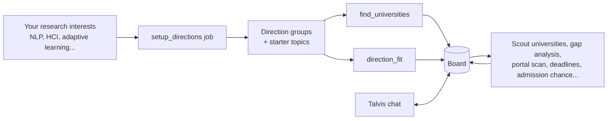
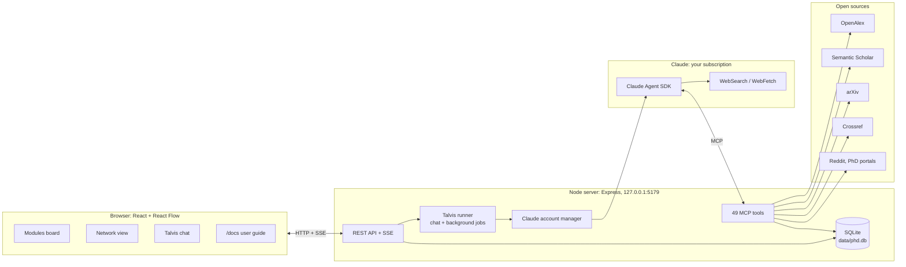

# PhD Analyzer

**An open-source research assistant for anyone planning a PhD.** Tell it what you are interested in (say *NLP, HCI, adaptive learning, LLMs*) and **Talvis**, its Claude-powered core, groups your interests into research directions, finds universities and supervisors that fit you, collects real papers and research gaps, scans PhD portals, checks deadlines on official pages, estimates your admission chance per university and plans your day. Everything lives on one board, and nothing is made up: every paper, ranking, deadline and link comes from a real source.


> **User guide:** [docs/GUIDE.md](docs/GUIDE.md), also built into the app at `/docs` (public, even when the app is password-protected).

---

## Contents

| | | |
|---|---|---|
| [What it does](#what-it-does) | [How it works](#how-it-works) | [Quick start](#quick-start) |
| [Modules](#modules) | [Background jobs](#background-jobs) | [Talvis tools (all 49)](#talvis-tools) |
| [Integrity rules](#integrity-rules) | [Data sources](#data-sources) | [Architecture](#architecture) |
| [Configuration](#configuration) | [Scripts](#scripts) | [REST API](#rest-api) |
| [Deploy to Google Cloud Run](#deploy-to-google-cloud-run) | [Data and privacy](#data-and-privacy) | [Project structure](#project-structure) |
| [Contributing](#contributing) | [License](#license) | |

---

## What it does

| Question you have | What PhD Analyzer does |
|---|---|
| I know my interests, but not my field | Groups your interests into 2-5 **direction groups** (e.g. *NLP, LLMs* → Natural language processing; *adaptive learning, HCI* → Human-computer interaction) and adds starter topics |
| Which direction fits me best? | Compares the groups on 8 weighted criteria (personal fit, your interest, PhD opportunities, supervisors, momentum, novelty, feasibility, career), each score with evidence |
| Where should I apply? | Finds universities that match your criteria (countries, QS/THE/ARWU limit, conditions such as "no IELTS/TOEFL", funded, no tuition) with **official source links** for rankings and language rules |
| What are my chances there? | Estimates an **admission chance (0-100)** per university from eligibility, competition, supervisor fit, funding and your record, sorts the list by it and explains why |
| Who could supervise me? | Finds researchers at a university who publish on your topic (OpenAlex): h-index, matching papers, still affiliated or not |
| Which positions are open? | Searches PhD portals (DAAD, jobs.ac.uk, AcademicPositions directly; FindAPhD, EURAXESS, PhDPortal, ScholarshipPortal, Nature Careers via web search) and saves funding, supervisor and deadline as published |
| When is the deadline? | Reads official admission pages, marks each date verified or unverified, counts down |
| What is still unsolved in my field? | Runs an evidence-based gap analysis across OpenAlex, Semantic Scholar and arXiv and tries to falsify each gap |
| What do students say about this place? | Analyses Reddit threads (supervision, stipend vs cost of living, workload, international students) with quotes and links |
| Where can I publish? | Suggests real journals and conferences with h-index, OA/APC, DOAJ status and predatory-journal warnings |
| What should I do today? | Builds a daily plan from deadlines, open tasks, unread papers and professors you have not contacted |
| SOP, proposal, emails | Drafts and reviews documents using the real data on your board |

---

## How it works



1. **Interests first.** The welcome screen asks only what you want to research. Talvis checks each interest in the literature, names the established fields and groups them.
2. **Research fills the board.** Background jobs search universities, supervisors, papers, positions and deadlines for the groups and save what passes your criteria.
3. **You decide with evidence.** Filter the board to one direction, compare directions, read admission-chance reasons, and ask Talvis anything in the chat.

---

## Quick start

**Requirements:** Node.js 20+, a Claude Pro or Max subscription (no API key needed), Windows, macOS or Linux.

```bash
git clone https://github.com/rzayevtaleh01/phd-analyzer.git
cd phd-analyzer
npm install
npm start
```

Open <http://localhost:5179>, click **Connect to Claude**, sign in, paste the code, then type your research interests on the welcome screen. On Windows, `Talvis.bat` does all of this with a double-click.

| Step | Where | What happens |
|---|---|---|
| 1 | Welcome screen | Type interests, optionally countries, click **Group my interests and start** |
| 2 | Directions card | Direction groups and starter topics appear |
| 3 | Universities panel | Matching universities appear with sources; click **AI: estimate admission chance** |
| 4 | Profile | Add citizenship, education, conditions and ranking limit for sharper results |
| 5 | Chat | Ask "What should I do today?" every morning |

---

## Modules

| Module | Stores | Main actions |
|---|---|---|
| **Profile** | Research interests, countries, ranking limit, conditions, citizenship, education, background | Group interests, find universities |
| **Directions** | Direction groups (keywords, status, your interest 1-5), evidence-based fit analysis | Compare all, analyse one, filter the board |
| **Universities** | Ranking and language rule (with sources), fit note, admission chance, status | AI search, search by name, estimate chances, Scout, deadlines, Reddit |
| **PhD positions** | Portal listings: university, funding, supervisor, deadline | Portal search, scan all portals |
| **Student voice** | Reddit analysis per university: themes, sentiment, quotes, caveats | Analyse a university, search Reddit |
| **Deadlines** | Application, scholarship, interview, document, conference, journal dates | Verify on official pages, countdown |
| **Today** | Tasks: overdue / today / upcoming | AI daily plan |
| **Documents** | SOP, proposal, CV, emails, cover letters, notes | Ask Talvis to write, Ask Talvis to review |
| **Topics** | Research topics, keywords, priority | Gap analysis, trend |
| **Research groups** | Labs, PI, link | Filled by Scout |
| **Researchers** | h-index, matching papers, relevance, contact status | Who works on this, their papers, email draft |
| **Papers** | Real papers, abstract, TLDR, reading status | Search three sources, related work |
| **Research gaps** | Gap, evidence papers, novelty, feasibility, methods | Gap analysis |
| **Publish** | Journals and conferences with fit, h-index, OA/APC, DOAJ | Venue matching |

Two views: **Modules** (cards around the chat) and **Network** (a knowledge graph of everything, chat docked beside it). A direction filter under the header narrows every card, panel and the graph to one direction group.

---

## Background jobs

Long research runs in the background with its own instructions; progress shows on the card and the report is posted in the chat.

| Job | Started from | What it does |
|---|---|---|
| `setup_directions` | Welcome screen, Profile, Directions | Turns interests into 2-5 direction groups with keywords, adds starter topics, starts `find_universities` and `direction_fit` |
| `find_universities` | Profile, Universities | Checks rankings on official sites, keeps universities with active researchers in your directions, verifies conditions on official pages, saves 6-12 matches with sources, fit notes and admission chances, lists excluded candidates and why |
| `admission_chance` | Universities | For each university (or one): official admission route, requirements, published acceptance numbers, supervisor fit, funding; saves a 0-100 estimate with reasons and source |
| `scout_university` | Universities | 4-8 matching researchers, their key papers, lab pages and PhD deadlines at one university |
| `verify_deadlines` | Deadlines, Universities | Checks dates on official pages, updates them, adds missing ones |
| `gap_analysis` | Topics, Research gaps | Maps the field with several phrasings and sources, drafts 5-8 gaps, falsifies each, saves 3-6 with evidence papers |
| `direction_fit` | Directions | Same depth of research per group (trend, papers, supervisors, positions, novelty, personal fit), scores 8 criteria, gives a verdict |
| `portal_scan` | PhD positions | Searches every portal for each direction, reads promising listings, saves those that pass your criteria |
| `student_voice` | Student voice, Universities | Finds the university's subreddit, runs 5-8 searches, reads the best threads, saves one insight with caveats |
| `venue_match` | Publish | Real venues for a title and abstract: scope, review time, APC, next deadline |
| `daily_plan` | Today | 3-6 concrete tasks for today with time estimates |

---

## Talvis tools

Talvis runs on the [Claude Agent SDK](https://docs.claude.com/en/docs/agent-sdk/overview) with an in-process MCP server. It can use **only** these 49 tools plus Claude's `WebSearch` and `WebFetch`; the file system, terminal and other built-in tools are disabled.

### Read the board

| Tool | What it does | Main inputs |
|---|---|---|
| `get_overview` | Fresh text snapshot of the whole board (also sent with every chat message) | - |
| `list_items` | Lists one collection, optionally filtered by text | `type`, `query`, `limit` |
| `get_item` | Full details of one item (paper abstracts, full document text) | `type`, `id` |

### Write to the board

| Tool | What it does | Guard |
|---|---|---|
| `save_profile` | Updates profile fields (interests, countries, ranking limit, conditions, citizenship, education...) | Only given fields change |
| `add_topic` | Adds a research topic with keywords and priority | Same title is not duplicated |
| `add_university` | Adds or updates a university; resolves its OpenAlex id; can carry rank, language rule, fit note and admission chance | `rankLabel` needs `rankSource`; `langCert` needs `langCertSource`; `admitChance` needs `admitNote` |
| `set_admission_chance` | Saves a 0-100 admission-chance estimate with reasons | Source URL must have appeared in a tool result |
| `add_deadline` | Saves a deadline (application, scholarship, interview, document, conference, journal) | `verified=true` needs an official `sourceUrl` |
| `add_task` | Adds a to-do task | Duplicates for the same day are skipped |
| `add_group` | Saves a research group or lab | Same name updates it |
| `add_researcher` | Saves a researcher; with an OpenAlex id the real metrics are fetched | - |
| `save_papers` | Saves up to 25 papers by OpenAlex id, DOI, arXiv id or Semantic Scholar id | Metadata is fetched from the source, never typed in |
| `add_gap` | Saves a research gap with evidence, novelty and feasibility (1-5), methods | Evidence must be papers already in the library |
| `add_venue` | Saves a journal or conference suggestion; with an OpenAlex id, real stats (h-index, OA, DOAJ, APC) | - |
| `save_document` | Creates or updates an SOP, CV, proposal, email, cover letter or note | - |
| `update_item` | Changes fields of any saved item | Verified deadlines still need a source |
| `delete_item` | Deletes an item | Only when the user explicitly asks |

### Scholarly research

| Tool | What it does | Source |
|---|---|---|
| `search_papers` | Searches papers by query, years and sort (relevance, cited, recent) | OpenAlex, Semantic Scholar, arXiv or all |
| `paper_details` | Full metadata and abstract of one paper | OpenAlex, Semantic Scholar, arXiv |
| `related_papers` | Citing works, references, or similar papers | OpenAlex, Semantic Scholar |
| `find_institution` | Finds a university or institute and its id | OpenAlex |
| `find_researchers_at` | Who at an institution publishes on a topic, with h-index and current affiliation | OpenAlex |
| `search_authors` | Finds a researcher by name, optionally at one institution | OpenAlex |
| `researcher_works` | A researcher's publications, optionally filtered by topic | OpenAlex |
| `find_venues` | Journals and conferences that publish similar work, with h-index, OA, DOAJ, APC | OpenAlex |
| `verify_doi` | Confirms that a DOI exists and returns its title, venue and year | Crossref |
| `topic_trend` | Publications per year for a topic | OpenAlex |

### The web

| Tool | What it does | Notes |
|---|---|---|
| `browse_page` | Reads any page, with a real browser when it needs JavaScript; returns text, links and schema.org JSON-LD | `find` pulls matching paragraphs, `linkFilter` follows sub-pages; bot checks are reported, never bypassed |
| `read_pdf` | Reads a PDF from a URL, or a library paper's open-access full text by its id | `find` returns passages with page numbers; `pages` reads a range |
| `reddit_search` | Searches Reddit posts, optionally in one subreddit | Official API with a key, public RSS without |
| `reddit_thread` | Reads a thread with its top comments | - |
| `find_subreddits` | Finds a university's or city's subreddit | - |
| `portal_search` | Searches PhD portals; returns listings, or a web query for portals that block automated search | DAAD, jobs.ac.uk, AcademicPositions, FindAPhD, EURAXESS, PhDPortal, ScholarshipPortal, Nature Careers |
| `save_position` | Saves a PhD position or programme | URL must have appeared in a tool result |
| `add_insight` | Saves a student-voice analysis with themes and evidence quotes | Every evidence URL must have been seen; at least 2 |

### Direction groups

| Tool | What it does | Guard |
|---|---|---|
| `save_direction` | Creates or updates a direction group (name, description, keywords, status) | Never changes the user's own interest rating |
| `tag_directions` | Puts board items into groups, overriding the automatic keyword grouping | Unknown group ids are refused |
| `save_direction_analysis` | Saves a group's 0-10 scores per criterion, summary, strengths, risks, next steps and evidence | Evidence must be board ids or URLs seen in tool results |

### Background

| Tool | What it does |
|---|---|
| `start_job` | Starts one of the [background jobs](#background-jobs) |

### TRDesk (optional integration)

These tools exist only when a TRDesk key is set in Settings; without it they are not offered to Talvis and TRDesk is hidden in the UI.

| Tool | What it does |
|---|---|
| `trdesk_plans` | Lists the user's TRDesk plans with progress |
| `trdesk_plan` | Reads a plan: tasks by date, done dates, day notes |
| `trdesk_sync` | Mirrors open deadlines and dated board tasks into the PhD plan; syncs completion both ways; never duplicates |
| `trdesk_add_tasks` | Adds tasks on given dates |
| `trdesk_update_task` | Edits or moves a task |
| `trdesk_task_done` | Marks a task done or not done |
| `trdesk_delete_task` | Deletes a task (only when asked) |
| `trdesk_day_note` | Writes the note of a plan day |
| `trdesk_manage_plan` | Creates, edits, archives, deletes or sets the default plan |
| `trdesk_agenda` | Tasks of all active plans between two dates |

### Built-in Claude tools

| Tool | Used for |
|---|---|
| `WebSearch` | Finding official university pages, rankings, requirements, deadlines, calls for papers |
| `WebFetch` | Reading simple pages (falls back to `browse_page` for JavaScript pages) |

---

## Integrity rules

These are enforced by the tools, not only asked for in the prompt.

| Rule | Enforcement |
|---|---|
| Papers cannot be invented | `save_papers` accepts only ids; title, authors, year and abstract are fetched server-side |
| No gap without evidence | `add_gap` accepts only papers already in the library |
| No verified deadline without a source | `add_deadline` / `update_item` require `sourceUrl` for `verified=true` |
| No ranking or language rule without a source | `add_university` requires `rankSource` and `langCertSource` |
| No invented links | `save_position`, `add_insight`, `set_admission_chance` and `save_direction_analysis` accept only URLs that appeared in a tool result |
| DOIs are checked | `verify_doi` asks Crossref |
| Admission chances are explained | Every estimate carries its reasons; the UI calls it an estimate |

---

## Data sources

| Service | Used for | Key | Notes |
|---|---|---|---|
| **Claude** (Anthropic) | Talvis: chat, planning, analysis | Not needed: sign in with a Claude Pro/Max subscription | Several accounts with automatic switching when one hits its limit |
| **Claude WebSearch / WebFetch** | Official pages: rankings, requirements, deadlines | Included | |
| **Local browser** (Edge/Chrome via `playwright-core`) | JavaScript pages, portals, PDFs behind landing pages | Not needed | `npm run browser:install` adds Chromium if neither browser exists |
| [OpenAlex](https://openalex.org) | Papers, citations, institutions, researchers, venues, trends | Optional (free) | Small daily budget without a key |
| [Semantic Scholar](https://www.semanticscholar.org/product/api) | Paper search, TLDRs, recommendations | Optional | Requests are queued and retried |
| [arXiv](https://info.arxiv.org/help/api/index.html) | Newest preprints | Not needed | One request per 3 seconds |
| [Crossref](https://www.crossref.org/documentation/retrieve-metadata/rest-api/) | DOI verification | Not needed | |
| [Reddit](https://www.reddit.com/dev/api/) | Student voice | Optional ("script" app) | Public RSS without a key |
| PhD portals | Positions and programmes | Not needed | robots.txt is respected; blocked portals go through `site:` web search |

External responses are cached in SQLite (6 hours to 30 days) to save rate limits.

---

## Architecture



| Part | Technology |
|---|---|
| Server | Node.js 20+, Express 5, TypeScript (tsx) |
| Database | SQLite (better-sqlite3, WAL); optional PostgreSQL mirror for hosting |
| AI | `@anthropic-ai/claude-agent-sdk`, in-process MCP server, `zod` schemas |
| Live updates | Server-Sent Events |
| Frontend | React 19, Vite 6, React Flow 12, d3-force, react-markdown, lucide-react |
| Browser automation | `playwright-core` with the installed Edge or Chrome |

---

## Configuration

### Settings (in the app: the gear button in the top bar)

| Setting | Options | Default |
|---|---|---|
| Model | Claude Opus 5.5, Sonnet 5.5, Fable 5.1, Haiku 5.5 | Claude Opus 5.5 |
| Board language | Any language name | English |
| Chat effort | low, medium, high, xhigh | medium |
| Research job effort | medium, high, xhigh, max | high |
| OpenAlex key / mailto, Semantic Scholar key | Optional keys | empty |
| Browser for JS-heavy sites | auto, Edge, Chrome, Chromium | auto |
| Show the browser window | on / off | off |
| Reddit client id / secret | Optional | empty |
| TRDesk key / address / plan | Optional integration | empty (off) |
| Automatic account switching | on / off | on |

### Environment variables

| Variable | Default | Meaning |
|---|---|---|
| `PORT` | `5179` | Server port |
| `HOST` | `127.0.0.1` | Listen address (`0.0.0.0` in the container) |
| `PHD_DATA_DIR` | `./data` | Data folder |
| `SESSION_SECRET` | random, stored in the database | Signs the 30-day session cookies |
| `DATABASE_URL` | - | PostgreSQL mirror of the board and server-side Claude logins |
| `PHD_USE_API_KEY` | - | `1` = use `ANTHROPIC_API_KEY` instead of a subscription |

---

## Scripts

| Command | What it does |
|---|---|
| `npm start` | Builds the UI and serves everything on port 5179 |
| `npm run dev` | API on 5179 with auto-restart + UI on 5178 with live reload |
| `npm run build` | Builds the UI into `dist/` |
| `npm run typecheck` | TypeScript check |
| `npm run serve` | Serves the last build without rebuilding |
| `npm run fetch -- page <url> [--browser] [--find "words"]` | Reads a page from the terminal |
| `npm run fetch -- reddit "<query>" [--sub PhD]` | Reddit search (`thread <url>`, `subs "<name>"` too) |
| `npm run fetch -- portals "<field>" [--country Germany]` | PhD portal search |
| `npm run fetch -- pdf <url> [--pages 1-3] [--find "words"]` | Reads a PDF |
| `npm run browser:check` / `browser:install` | Checks the browser / downloads Chromium |
| `npm run db:push [-- --force \| --logins-only]` | Copies the local board (or only the Claude logins) to PostgreSQL |

---

## REST API

<details>
<summary>All endpoints under <code>/api</code> (click to expand)</summary>

| Method | Path | Purpose |
|---|---|---|
| GET | `/state` | Full board snapshot |
| GET | `/events` | Server-Sent Events: changes, activity, chat, jobs, Claude status |
| PUT | `/profile` | Save the profile |
| GET / PUT | `/settings` | Read / save settings |
| GET / POST / PATCH / DELETE | `/items/:coll[/:id]` | CRUD for topics, universities, groups, researchers, papers, deadlines, tasks, gaps, venues, docs, positions, insights, directions |
| GET | `/research/papers`, `/research/institutions`, `/research/researchers`, `/research/author-works`, `/research/venues`, `/research/trend` | Direct scholarly searches |
| POST | `/research/save-paper`, `/research/save-researcher`, `/research/save-venue` | Save a search result |
| POST | `/universities/resolve` | Add a university resolved in OpenAlex |
| GET | `/portals`, `/portals/search` | Portal list and search |
| POST | `/positions` | Save a position |
| GET | `/reddit/search`, `/reddit/thread`, `/reddit/subreddits` | Reddit |
| GET | `/browse`, `/browser/status` | Page reader, browser check |
| GET / POST | `/chat`, `/chat/stop`, `/chat/new` | Chat with Talvis |
| POST | `/jobs`, `/jobs/:id/stop` | Start / stop a background job |
| GET / POST | `/claude`, `/claude/login`, `/claude/login/code`, `/claude/login/cancel` | Claude status and in-app sign-in |
| GET / POST / PATCH / DELETE | `/accounts[/:id]`, `/accounts/:id/activate`, `/accounts/:id/check`, `/accounts/auto-switch` | Claude accounts |
| GET / POST | `/auth`, `/auth/register`, `/auth/login`, `/auth/logout`, `/auth/password` | Accounts: each has its own board; the first is the admin |
| GET / POST / PUT | `/trdesk/upcoming`, `/trdesk/sync`, `/trdesk/tasks/:id/done` | Optional TRDesk integration |

</details>

---

## Deploy to Google Cloud Run

The hosted app keeps its data in **PostgreSQL** (for example Neon) and is protected by a **password**; the user guide at `/docs` stays public so you can link to it.

```powershell
powershell -ExecutionPolicy Bypass -File deploy.ps1 -Project <your-gcp-project> [-Region us-east4] [-Service phd-analyzer]
```

The script asks once for the Postgres connection string and the login password, stores them in Secret Manager, grants the Cloud Run service account access and deploys the `Dockerfile` (Playwright image with Node and Chromium).

| Topic | Detail |
|---|---|
| Data | With `DATABASE_URL`, `server/start.ts` fills a local SQLite working copy from Postgres on start and `server/pgsync.ts` mirrors every write back within about a second. Run one instance per database |
| Logins | Claude sign-ins made on the server (`data/accounts/*`) are backed up to Postgres, so restarts keep you signed in |
| Access | Every `/api` route except `/api/auth*` needs a signed-in account (signed httpOnly cookie, 30 days; passwords stored as scrypt hashes; 8 failed tries per 10 minutes per address). Each request runs as its account (`server/ctx.ts`), and every board table carries a `uid`. Settings and Claude accounts are admin-only. Anyone who can open the app can create an account |
| Cost | Scales to zero; billed while a browser tab keeps the live event stream open |

---

## Data and privacy

- The board stays on your computer in `data/phd.db`; the server listens on `127.0.0.1` only.
- Claude sign-ins: account 1 in your default Claude folder, extra accounts in `data/accounts/`.
- Chat messages and the board summary go to Claude under Anthropic's terms; search queries go to the scholarly APIs, Reddit and portals; keys go only to their own service.
- Student-voice analyses quote public posts with links and never profile individual users.
- `data/`, `dist/` and `node_modules/` are git-ignored.

---

## Project structure

<details>
<summary>Folders and files (click to expand)</summary>

```text
├── server/
│   ├── index.ts            REST API, SSE, static UI
│   ├── start.ts            Entry point (restores from Postgres when DATABASE_URL is set)
│   ├── db.ts               SQLite data, profile, settings, chat, cache
│   ├── auth.ts             Optional password login
│   ├── pgsync.ts           PostgreSQL mirror for hosting
│   ├── library.ts          Saving search results without duplicates
│   ├── agent/
│   │   ├── runner.ts       Chat, background jobs, account failover
│   │   ├── tools.ts        49 MCP tools
│   │   ├── prompts.ts      Talvis and job instructions
│   │   ├── overview.ts     Board summary sent with every message
│   │   ├── accounts.ts     Claude accounts, usage, limits
│   │   └── login.ts        In-app Claude sign-in
│   ├── research/           OpenAlex, Semantic Scholar, arXiv, Crossref, Reddit, PhD portals, HTTP queue
│   ├── browser/            Real-browser page reader, PDF reader, robots.txt
│   └── integrations/
│       └── trdesk.ts       Optional TRDesk task-manager integration
├── shared/
│   ├── types.ts            Data model
│   ├── criteria.ts         Profile conditions, ranking options, admission-chance bands
│   └── directions.ts       Direction grouping and comparison criteria
├── web/src/
│   ├── App.tsx             Header, views, welcome screen
│   ├── Docs.tsx            In-app user guide (renders docs/GUIDE.md at /docs)
│   ├── store.tsx           State, SSE, actions
│   ├── board/              Board, cards, chat, network view, welcome
│   ├── modules/            Card summaries and module registry
│   └── panels/             Module panels, Claude accounts
├── docs/GUIDE.md           User guide
├── scripts/                Terminal tools (fetch, db-push)
├── Dockerfile, deploy.ps1  Hosting
└── Talvis.bat              Windows launcher
```

</details>

---

## Contributing

Issues and pull requests are welcome. Good first areas: more PhD portals (`server/research/portals.ts`), new background jobs (`server/agent/prompts.ts` + `runner.ts`), and UI improvements. Please keep the integrity rules: anything Talvis saves must come from a tool result or an official page. Run `npm run typecheck` before opening a pull request.

## License

[MIT](LICENSE)
